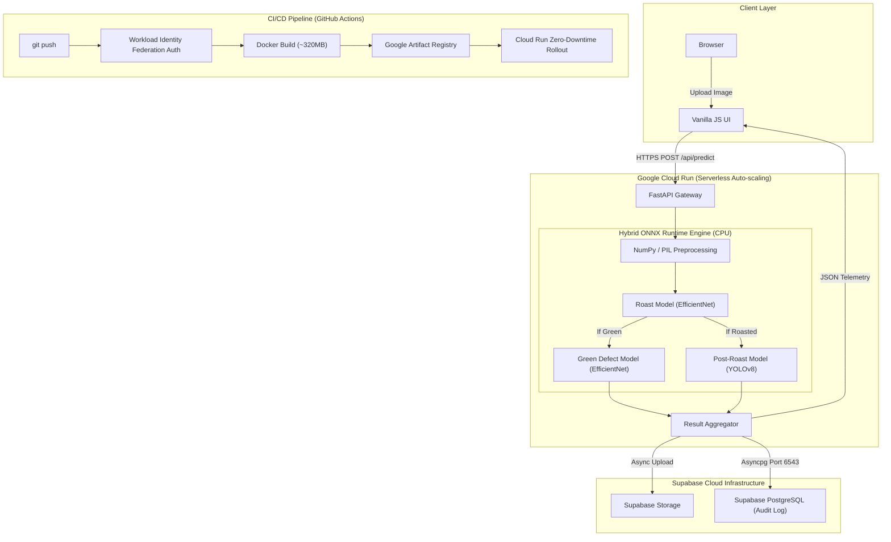

# ☕ BeanSight
### **Roast classification and defect detection for coffee beans**

[](https://coffee-bean-analyzer-876034946934.us-central1.run.app)
[](https://www.python.org/)
[](https://fastapi.tiangolo.com/)
[](https://onnxruntime.ai/)
[](https://www.docker.com/)
[](https://supabase.com/)
[](https://github.com/anoopsachdev/BeanSight/actions)

<p align="center">
  <strong>Upload a coffee bean photo and select the green or roasted workflow (or use automatic routing). BeanSight runs the matching defect model — a 17-class classifier for green (unroasted) beans or a YOLOv8 detector for roasted beans. Three PyTorch models exported to ONNX and served from a single CPU container on Cloud Run.</strong>
</p>

[**Open the live app »**](https://coffee-bean-analyzer-876034946934.us-central1.run.app)

---

## 💡 What it does

Green (unroasted) coffee and roasted coffee have different defect taxonomies, so one model can't grade both. BeanSight serves three models. The roast classifier can route automatically, or the user can explicitly select the green or roasted defect workflow:

### Stage 1 — Roast level (router)
* **Model:** EfficientNet-B0 image classifier, 224 × 224 input.
* **Classes (4):** `Green`, `Light`, `Medium`, `Dark`.
* **Output:** predicted roast level with the full probability distribution. In auto mode, `Green` routes to Stage 2A and anything else to Stage 2B. Because image classifiers can be wrong on out-of-distribution photos, the UI provides a manual green/roasted override.

### Stage 2A — Green bean defect classifier
* **Model:** EfficientNet-B0 image classifier, trained on single-bean images.
* **Classes (17):** Broken, Cut, Dry Cherry, Fade, Floater, Full Black, Full Sour, Fungus Damage, Husk, Immature, Parchment, Partial Black, Partial Sour, Severe Insect Damage, Shell, Slight Insect Damage, Withered.
* **Output:** predicted defect class, its probability, and the full 17-class distribution. The UI also tags the class with its SCA defect category (Category 1 / Category 2).
* **Scope:** one bean per photo.

### Stage 2B — Roasted bean defect detector
* **Model:** YOLOv8n object detector, 640 × 640 letterboxed input, NumPy NMS.
* **Classes (4):** `Normal`, `Broken`, `Quaker`, `Scorched` — one label per detected bean.
* **Output:** number of beans found, how many look normal, how many are defective and of which type, plus an annotated image with colour-coded boxes.
* **Scope:** one bean or a handful of beans per photo.

Each analysis is logged to PostgreSQL (roast result + defect result) and the uploaded image is stored in Supabase Storage so the UI can show recent activity and simple aggregates.

---

## ⚡ Engineering Problem-Solving & "Zero Heavy ML"

> *"The goal wasn't just to build a model that worked in a Jupyter Notebook; the challenge was building a production-ready, edge-optimized application with zero GPU dependency for serverless deployment."*

```
Traditional ML Deployment                BeanSight Optimized Architecture
┌───────────────────────────────┐        ┌───────────────────────────────┐
│  PyTorch 2.3 + TorchVision    │        │  Pillow + NumPy Preprocessing │
│  CUDA Libraries & Bloat       │   →    │  ONNX Runtime (CPU Provider)  │
│  Container Size: ~4.2 GB      │        │  Container Size: ~320 MB      │
│  Cold Start: 12-18 seconds    │        │  Cold Start: < 1.2 seconds    │
│  Inference: 450ms (CPU)       │        │  Inference: ~150ms (CPU)      │
└───────────────────────────────┘        └───────────────────────────────┘
```

### 1. PyTorch to ONNX Graph Optimization
Standard PyTorch container deployments require 4GB+ Docker images and heavy memory overhead. By exporting the models to **ONNX computation graphs** and serving inference through **ONNX Runtime (CPU Execution Provider)**:
* Stripped `torch`, `torchvision`, and `ultralytics` from production dependencies.
* Slashed container footprint from **~4.2GB down to ~320MB** (a **92% reduction**).
* Kept inference latency to **~150ms** on serverless Cloud Run instances despite running two sequential deep learning models on a single CPU core.

### 2. Non-Blocking FastAPI Lifespan
Cloud Run automatically checks port bindings to determine container health. Loading three ONNX models into memory synchronously blocks the `asyncio` event loop. BeanSight solves this by utilizing `asyncio.to_thread()` and background tasks during the FastAPI lifespan to parse the models lazily—ensuring the application binds to `$PORT` and passes health checks in `<250ms`.

### 3. Asynchronous Telemetry & Resilient Persistence
* **Non-blocking logging:** Predictions compute and return immediately while image uploads (Supabase Storage) and audit logging (Supabase PostgreSQL via `asyncpg`) execute concurrently as best-effort tasks.
* **pgBouncer pooler compatibility:** Configured SQLAlchemy async engine with `statement_cache_size=0` to support transaction-mode database pooling on port `6543`.

---

## 🏗️ System Architecture



---

## 🛠️ Technology Stack Matrix

```
Machine Learning & Inference
├── Training: PyTorch 2.3, Ultralytics, TorchVision
├── Model Architecture: Hybrid (EfficientNet-B0 + YOLOv8)
├── Production Inference: ONNX Runtime 1.18 (CPU Execution Provider)
└── Preprocessing: Pillow (PIL) + NumPy

Backend & API Architecture
├── Web Framework: FastAPI 0.111 (Python 3.11)
├── Server: Uvicorn (ASGI async worker)
└── Rate Limiting: SlowAPI (X-Forwarded-For proxy tracking)

Cloud Infrastructure & Database
├── Compute: Google Cloud Run (Serverless, auto-scaling)
├── Database: Supabase PostgreSQL (SQLAlchemy 2.0 + asyncpg)
└── Object Storage: Supabase Storage S3-compatible bucket

DevOps & Security
├── CI/CD: GitHub Actions (Automated build & deployment)
├── Cloud Security: Workload Identity Federation (Keyless GCP Auth)
└── Frontend: Vanilla JS / CSS (no build step)
```

---

## 📡 Production API Reference

### `POST /api/predict`
Multipart upload (`file`) with optional `bean_type` (`auto`, `green`, or `roasted`; default `auto`). The roast classifier always runs; `route` tells you which defect model ran and the response contains either `defect` (green) or `roasted_defect` + a compact `defect` summary (roasted).

**Example response — green bean (`route: "green"`):**
```json
{
  "roast": {
    "prediction": "Green",
    "confidence": 0.97,
    "probabilities": { "Dark": 0.01, "Green": 0.97, "Light": 0.01, "Medium": 0.01 }
  },
  "route": "green",
  "defect": {
    "type": "green_agricultural",
    "prediction": "Slight Insect Damage",
    "confidence": 0.88,
    "probabilities": { "...17 classes...": 0.0 }
  },
  "inference_time_ms": 92.4,
  "image_url": "https://[...].supabase.co/storage/v1/object/public/coffee-uploads/predictions/[...].jpg"
}
```

**Example response — roasted beans (`route: "roasted"`):**
```json
{
  "roast": {
    "prediction": "Medium",
    "confidence": 0.95,
    "probabilities": { "Dark": 0.02, "Green": 0.01, "Light": 0.02, "Medium": 0.95 }
  },
  "route": "roasted",
  "roasted_defect": {
    "type": "roasted_mechanical",
    "bean_count": 12,
    "normal_count": 10,
    "defect_count": 2,
    "defect_summary": { "Quaker": 2 },
    "class_summary": { "Normal": 10, "Quaker": 2 },
    "mean_confidence": 0.71,
    "detections": [ { "class": "Quaker", "confidence": 0.81, "box": [x1, y1, x2, y2] } ],
    "annotated_image": "data:image/jpeg;base64,/9j/4AAQSkZJRg..."
  },
  "defect": {
    "type": "roasted_mechanical",
    "prediction": "Quaker",
    "confidence": 0.79,
    "probabilities": { "Broken": 0.0, "Quaker": 0.1667, "Normal": 0.8333, "Scorched": 0.0 }
  },
  "inference_time_ms": 118.6,
  "image_url": "https://[...]"
}
```

For roasted samples, `defect.confidence` is the mean detector score of the defect boxes and `defect.probabilities` is the share of detected beans per class.

### Additional Endpoints
* `GET /health` — Load status of the three ONNX models.
* `GET /api/history?limit=20` — Recent logged analyses (one `roast` row and one `defect` / `roasted_defect` row per image).
* `GET /api/stats` — Aggregates: images analysed, average latency, roast distribution, defect distribution.

---

## 💻 Local Quickstart Guide

### Option 1: Docker (Recommended)

```bash
# 1. Clone repository
git clone https://github.com/anoopsachdev/BeanSight.git
cd BeanSight

# 2. Configure environment variables
cp .env.example .env

# 3. Build & Run Docker container
docker build -t beansight .
docker run -p 8080:8080 --env-file .env beansight

# 4. Open application
open http://localhost:8080
```

### Option 2: Python Virtual Environment

```bash
# 1. Setup virtual environment
python3.11 -m venv .venv
source .venv/bin/activate

# 2. Install production dependencies
pip install --upgrade pip
pip install -r requirements.txt

# 3. Launch development server with reload
uvicorn app.main:app --host 0.0.0.0 --port 8080 --reload
```

---

## 🔒 Security & Workload Identity Federation (WIF)

BeanSight's CI/CD pipeline implements enterprise-grade **Keyless Authentication** using Google Cloud Workload Identity Federation. No long-lived service account JSON keys are stored in GitHub Secrets.

```yaml
# Sample from .github/workflows/deploy.yml
- name: Authenticate to Google Cloud
  uses: google-github-actions/auth@v2
  with:
    workload_identity_provider: ${{ secrets.WIF_PROVIDER }}
    service_account: ${{ secrets.WIF_SERVICE_ACCOUNT }}
    token_format: 'access_token'
```

---

## 👨‍💻 Author

**Anoop Singh Sachdev**  
*Computer Vision & Deep Learning Engineer*  
*Specialty Coffee Enthusiast & System Architect*

* GitHub: [@anoopsachdev](https://github.com/anoopsachdev)
* Project Repo: [BeanSight](https://github.com/anoopsachdev/BeanSight)
* Live Cloud Run Instance: [BeanSight Web Service](https://coffee-bean-analyzer-876034946934.us-central1.run.app)

---

<div align="center">
  <sub>Built with passion for specialty coffee roasters worldwide. Licensed under the MIT License.</sub>
</div>
